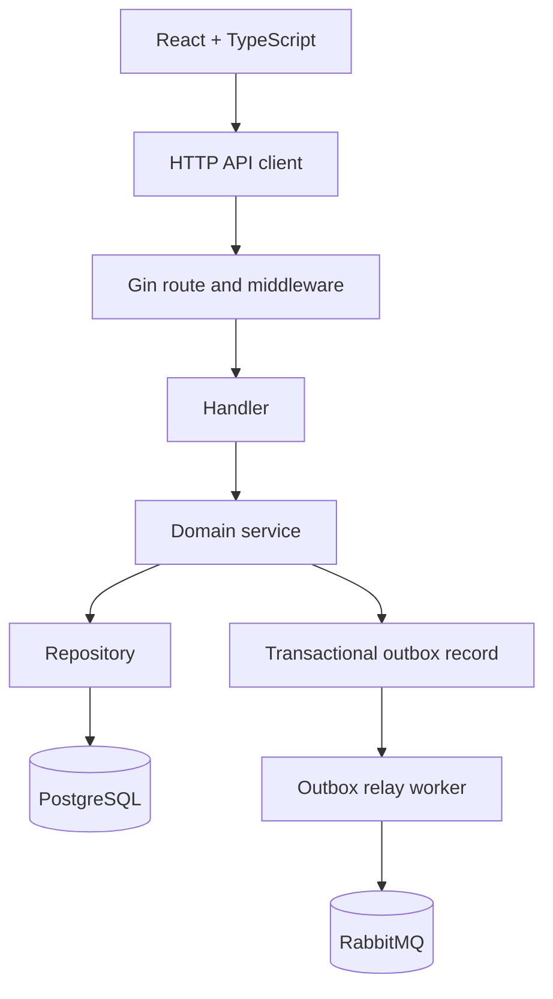

# AisHealth — Public Architecture Reference

AisHealth is an actively developed Hospital Information System (SIMRS) portfolio project. This repository contains a **public architecture reference and selected foundation code** for the wider application.

> **Scope note:** This is not the complete, standalone application repository. The full SIMRS implementation is maintained in a separate private repository. The files here are reference material and selected code foundations; this repository is not expected to build or run as a complete SIMRS on its own.

## Application technology

The wider AisHealth application uses:

| Area | Technology |
|---|---|
| Frontend | React, TypeScript, Vite, Tailwind CSS |
| Backend | Go, Gin, GORM |
| Database | PostgreSQL |
| Cache | Redis |
| Messaging | RabbitMQ |

The application is structured as a Go modular monolith with domain-oriented handlers, services, repositories, and a React/TypeScript client.

## Request and data flow

A typical request follows this path:



The outbox pattern is used to record application events alongside database changes before they are dispatched asynchronously. Delivery and processing guarantees depend on the relay, broker acknowledgement settings, retries, and consumer idempotency; this repository does not claim exactly-once processing.

## What this repository contains

```text
.
├── README.md
├── frontend/
│   └── src/
│       └── App.tsx
└── internal/
    └── database/
        └── database.go
```

- **`frontend/src/App.tsx`** — a reference for the React application route composition and major feature areas. The page components it imports are part of the private application source and are not included here.
- **`internal/database/database.go`** — selected Go/GORM database foundation code, including UUIDv7 creation and audit callback examples. The full backend module and its dependency manifest are maintained in the private application repository.

## Engineering topics represented in the wider project

- Domain-oriented API structure with handlers, services, and repositories.
- PostgreSQL-backed workflows and transaction boundaries.
- Pharmacy inventory, batch tracking, and stock-transfer workflows.
- Role- and permission-based access control.
- Redis-backed application state and RabbitMQ-based asynchronous processing.
- Shared TypeScript contracts for frontend forms and API responses.

These topics describe areas of the wider codebase; the presence of a topic in this overview does not imply that every workflow is complete, independently deployed, or production-validated.

## Project status and data safety

AisHealth is an **active development and portfolio project**. It is not certified or approved for clinical use. Do not use it to make patient-care decisions, connect it to real patient records, or place real patient information in development databases, screenshots, or test fixtures.

No performance figures, delivery guarantees, or production-readiness claims are made in this reference.

## Walkthrough

[Watch the AisHealth project walkthrough](https://youtu.be/iMKNz35sLt8).

## Author

**Haris Pratama** · [LinkedIn](https://www.linkedin.com/in/haris-pratama-dev/)
